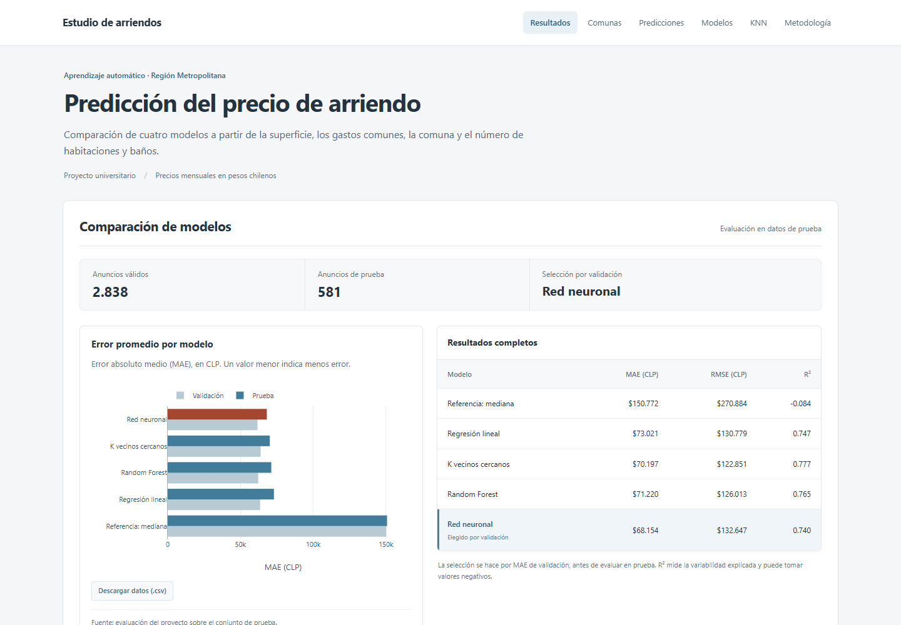

# Estimación de arriendos con machine learning

[](https://github.com/HectorEstepa/prediccion-arriendos-ml/actions/workflows/tests.yml)

Proyecto universitario para estimar el precio mensual de arriendo de una propiedad a partir de su comuna, superficie, gastos comunes, habitaciones y baños. Compara **regresión lineal, KNN, Random Forest y una red neuronal**, junto con una referencia que predice la mediana. Incluye una interfaz web responsiva conectada a los modelos reales mediante FastAPI.

El objetivo es mostrar un flujo de ciencia de datos evaluable y reproducible a partir del CSV disponible. Los resultados son académicos y corresponden a una muestra histórica; no constituyen una tasación ni una estimación de compraventa.



[Comparación de comunas](docs/comparacion-comunas.png) · [Análisis de los modelos](docs/analisis-modelos.png) · [Versión original del trabajo](original/README.md)

La presentación usa un estilo de informe y **18 gráficos interactivos de Plotly**. Recupera el análisis de comunas, la comparación entre modelos, los residuos y las explicaciones por algoritmo del HTML original. Plotly 4.1.1 se incluye localmente con su licencia en `web/vendor/`; no requiere cuenta ni conexión a internet. La comparación de métricas y las predicciones de prueba pueden descargarse en CSV desde la página.

La interfaz agrupa los análisis en secciones con fondos suaves, controles consistentes y una navegación fija que indica la sección actual. Incluye accesos directos a los detalles de cada algoritmo; en móvil, la navegación se desplaza horizontalmente.

En **Comparación de comunas** puedes elegir tres comunas y fijar superficie, gastos, habitaciones y baños. El servidor calcula esa misma propiedad con los cuatro modelos y la referencia. Los rankings y diagramas de caja muestran precios observados; las barras del comparador muestran precios estimados. En **Interpretación de los modelos** están los coeficientes de regresión lineal, las importancias de Random Forest y la arquitectura y pérdida de la red neuronal. **Clasificación y vecinos de KNN** incluye matriz de confusión, ROC, sensibilidad, precisión, F1, vecinos reales y diagnóstico de K en validación.

En la evaluación incluida, la red neuronal fue seleccionada por validación y obtuvo un **MAE de prueba de $68.154 CLP** sobre 581 anuncios. La referencia de mediana obtuvo $150.772 CLP. Estos errores corresponden al alcance filtrado descrito más abajo.

## Inicio rápido

Requisitos: **Python 3.13** (versión usada en la revisión) y una terminal abierta en esta carpeta. No se necesitan servicios externos, claves ni librerías de JavaScript desde una CDN.

```powershell
python -m venv .venv
.venv\Scripts\Activate.ps1
python -m pip install -r requirements.txt
python -m arriendos.train
python -m uvicorn arriendos.api:app --host 127.0.0.1 --port 8000
```

Abre [la aplicación local](http://127.0.0.1:8000). Los endpoints y sus esquemas están en [la documentación local de la API](http://127.0.0.1:8000/docs). Para detener el servidor, presiona `Ctrl+C`.

Si PowerShell impide activar el entorno, ejecuta los comandos con `.venv\Scripts\python.exe` en lugar de `python`; no es necesario cambiar la política del sistema. En macOS/Linux, activa el entorno con `source .venv/bin/activate`.

El repositorio incluye `data/propiedades.csv`, una copia del conjunto sin títulos ni direcciones. El comando de entrenamiento la utiliza automáticamente; no hace falta buscar un archivo externo. Para usar otro CSV compatible:

```powershell
python -m arriendos.train --data "C:\ruta\DatosRevisadosLimpios.csv"
```

Los modelos se generan localmente en `artifacts/` al entrenar. Después puedes iniciar el servidor sin volver a entrenar. El proceso no abre ventanas ni pide entrada interactiva.

## Trabajo original

La carpeta [`original/`](original/README.md) conserva los scripts, HTML, JSON y figuras del trabajo inicial, sin modificaciones. Puedes abrir `original/super.html` para consultar la interfaz original. Para probar los scripts con el CSV sin direcciones, ejecuta primero `python scripts/preparar_original.py` y sigue las instrucciones de esa carpeta. La aplicación principal contiene la evaluación y las predicciones corregidas.

## Datos y alcance

El conjunto recibido contiene **3.247 anuncios**. Las cuatro copias entregadas eran idénticas y se consolidaron en un único archivo. La copia incluida conserva precio, gastos comunes, comuna, superficie, habitaciones y baños. La fuente fue un scraping realizado en el trabajo original, pero **no se conserva su código, el sitio de origen, la fecha ni una licencia verificable del conjunto**. La obtención original no puede reproducirse. Esta publicación no asigna una licencia nueva a los datos.

| Columna del CSV | Uso |
| --- | --- |
| `Precio ($)` | Objetivo: arriendo mensual, interpretado en CLP según el trabajo original |
| `Metros (m²)` | Superficie |
| `Gastos_Comunes ($)` | Gasto mensual, conocido al hacer la estimación |
| `Habitaciones`, `Baños` | Recuentos enteros |
| `Comuna` | Variable categórica |
| `Grupo` | Identificador sustituto del grupo de comuna/dirección; no entra en el modelo |
| `Registro` | Conserva la identidad de duplicados exactos sin publicar el título; no entra en el modelo |

Los campos originales `Direccion` y `Nombre_Arriendo` no se publican. `Grupo` y `Registro` permiten conservar el orden, la eliminación de duplicados y las mismas particiones del conjunto inicial. La conversión se realiza con `scripts/preparar_datos_publicos.py`; el CSV original completo queda excluido de Git.

Se eliminan duplicados exactos, registros incompletos, valores no finitos y valores físicamente inválidos. Se mantiene el alcance fijado en la RN original: precios entre **$100.000 y $2.000.000** y superficies entre **15 y 200 m²**. Los valores de precio muy bajos pueden deberse a unidades diferentes o errores, pero no se convierten a CLP por falta de evidencia. Los filtros restringen el estudio; no certifican la calidad de todos los anuncios restantes.

El archivo [de evaluación](reports/EVALUACION.md) y el [reporte JSON](reports/evaluacion.json) registran las filas descartadas, la partición, las métricas, las versiones y el SHA-256 del CSV. No contienen títulos ni direcciones.

## Metodología

1. Validar y limpiar el CSV con reglas explícitas.
2. Agrupar mediante comuna y `Grupo` de la copia pública (o comuna/dirección normalizadas al cargar un CSV original). Reservar el 20% de los grupos para prueba; del resto, reservar el 20% para validación. Las proporciones de filas pueden variar porque los grupos tienen distintos números de anuncios.
3. Ajustar el preprocesamiento exclusivamente en entrenamiento: escalado numérico y codificación de comuna. La red neuronal también estandariza el precio objetivo dentro del estimador.
4. Comparar configuraciones fijas con MAE de validación y seleccionar el menor, incluyendo la referencia de mediana. No se optimizan parámetros ni pesos con los resultados de prueba.
5. Volver a ajustar cada configuración con entrenamiento + validación y evaluar en la misma prueba reservada. Guardar las cinco tuberías completas y las predicciones reales del conjunto de prueba.
6. Servir predicciones mediante `/api/predict`. La interfaz consulta esas tuberías y construye su gráfico con las predicciones del reporte, sin fórmulas aproximadas ni ruido aleatorio.

KNN también incluye un experimento de **clasificación binaria independiente**: precio por debajo o desde la media de entrenamiento + validación. Su matriz de confusión, accuracy, F1 y ROC se calculan en prueba. La categoría no representa una tercera clase ni necesariamente coincide con el precio de otro modelo.

MAE y RMSE se expresan en CLP. R² es adimensional y puede ser negativo. El MAE no es un porcentaje de exactitud ni un intervalo para una propiedad individual. El tamaño de la muestra por comuna es desigual; no hay validación temporal ni geográfica externa. La agrupación por dirección reduce la fuga, pero sin identificadores originales no garantiza reconocer todos los anuncios repetidos con direcciones distintas.

La API rechaza comunas no observadas en el ajuste final, datos no finitos y valores fuera del dominio de entrada. Advierte cuando una variable sale del rango numérico observado; esta comprobación no detecta todas las combinaciones poco representadas. Las predicciones no positivas se rechazan en lugar de presentar un precio inventado.

## Estructura

```text
arriendos/          Carga de datos, entrenamiento y API
web/               HTML, CSS, JavaScript y distribución local de Plotly
tests/             Pruebas con datos sintéticos; no requieren el CSV privado
data/raw/          CSV local, excluido de Git
data/propiedades.csv Datos incluidos sin títulos ni direcciones
artifacts/         Tuberías entrenadas, excluidas de Git
original/          Scripts, HTML y recursos originales conservados
scripts/           Preparación de datos y ejecución de originales
reports/           Resultados y evaluación del conjunto recibido
docs/              Revisión técnica y procedencia
.github/workflows/ Verificación automatizada
```

## Verificación

```powershell
python -m pip install -r requirements-dev.txt
python -m pytest -q
```

Las pruebas verifican limpieza, separación de grupos, métricas recalculables, selección por validación, correspondencia entre predicción HTTP y tubería guardada, entradas inválidas y comportamiento sin modelos. GitHub Actions ejecuta estas pruebas con un CSV sintético, sin acceso al conjunto original.

## Publicación en GitHub

`.gitignore` excluye el CSV privado original, modelos serializados, entornos y cachés. El CSV preparado para publicar sí forma parte del repositorio. Para probar el proyecto, clona o descarga el repositorio y sigue el inicio rápido.

El repositorio permite reproducir el procedimiento y sus resultados con los datos incluidos, pero no reconstruir el scraping desde la web. GitHub Pages solo sirve archivos estáticos: para usar esta interfaz con predicciones se necesita ejecutar también la API Python.

No se ha añadido una licencia general de software: la decisión corresponde a los autores del trabajo. La licencia MIT de Plotly se conserva en `web/vendor/LICENSE-plotly.txt`. La procedencia y las limitaciones del conjunto se documentan en [PROCEDENCIA.md](docs/PROCEDENCIA.md). Los archivos joblib deben generarse localmente o proceder de una fuente de confianza, ya que su carga puede ejecutar código.

## Referencias metodológicas

- [Prevención de fuga y preprocesamiento consistente, scikit-learn](https://scikit-learn.org/stable/common_pitfalls.html).
- [Particiones por grupos con GroupShuffleSplit, scikit-learn](https://scikit-learn.org/stable/modules/generated/sklearn.model_selection.GroupShuffleSplit.html).
